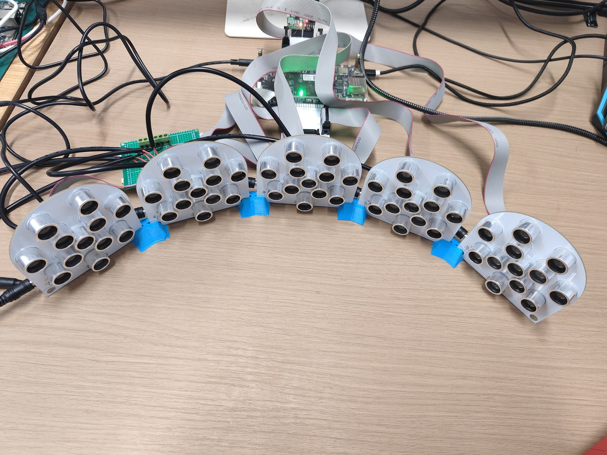
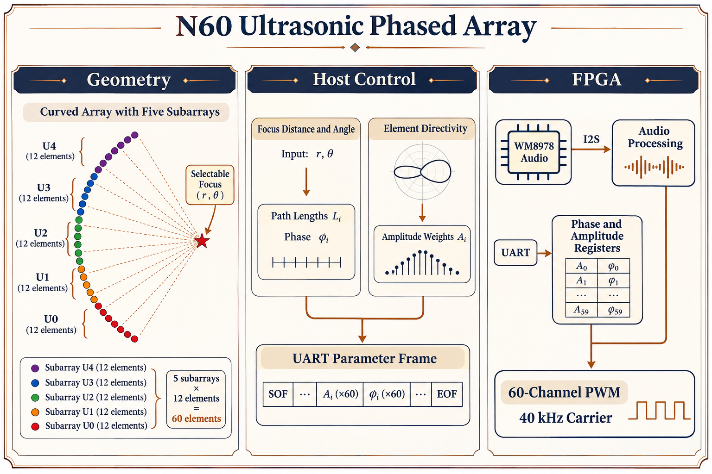

# N60 Ultrasonic Phased Array

[中文](#中文) · [English](#english)

<p align="center">
  
  <br>
  <em>N60 实物 · Hardware prototype</em>
</p>

## 中文

2026 年利利普杯工程。上位机计算 60 路阵元的相位与幅度，通过 UART 下发给 FPGA。FPGA 将音频与各阵元参数结合，生成 60 路 40 kHz 载波 PWM，供外部驱动级使用。

### 原理与实现



| 环节 | 实现 |
| --- | --- |
| 阵列几何 | 5 个子阵，每组 12 个阵元。上位机根据目标距离和角度计算各阵元到焦点的路径长度，并把相对路径差映射到每周期 2,500 个相位刻度 |
| 幅度加权 | 在线模式使用阵元方向与目标方向的点积计算权重。离线模式从生成的 CSV 选择最接近目标的参数 |
| 串口配置 | 115200 baud。帧格式为 `AA BB 01`、60 个幅度字节、60 个小端 16 位相位值、8 位累加校验、`0D 0A` |
| 音频与调制 | WM8978 音频经 I²S 接收，左声道经过噪声门、增益和饱和处理。另有 1 kHz DDS 测试信号。PWM 模块使用 ROM 映射，并结合逐通道相位和幅度生成载波 |

[阵列与焦点计算](docs/beamforming.md) · [相位、幅度及协议详解](docs/phase-and-amplitude.md)

### 运行与构建

在仓库根目录运行以下命令。生成的 CSV 放在 `analysis_outputs/`，供离线查表使用。

```powershell
python -m pip install -r requirements.txt
python generate_n60_csv.py
python n60_beam_params.py
```

使用 Vivado 2025.2 打开 [adc_capture.xpr](adc_capture/adc_capture.xpr)，目标器件为 `xc7z020clg400-1`。工程顶层为 `top_ultrasound_array`。生成 IP 输出产品后执行综合。行为仿真入口 `tb_i2s_rx_master` 用于检查 I²S 接收。板端复现需要匹配 [XDC](adc_capture/adc_capture.srcs/constrs_1/new/top_cons.xdc) 的硬件和外部驱动级。

## English

A 2026 competition project for an N60 ultrasonic phased array. The host computes phase and amplitude for 60 elements and sends the settings over UART. The FPGA combines them with an audio stream to generate 60 PWM outputs on a 40 kHz carrier.

### Signal paths

- **Focusing and weighting.** Five 12-element subarrays form the geometry model. The host converts path-length differences to phase ticks and applies element directivity weights or reads the nearest entry from an offline table.
- **UART control.** At 115200 baud, the host sends an `AA BB 01` header, 60 amplitude bytes, 60 little-endian 16-bit phase words, an 8-bit additive checksum, and the `0D 0A` trailer.
- **Audio modulation.** The design selects either WM8978 I²S audio with gating, gain, and saturation or a 1 kHz DDS test signal. ROM-based mapping feeds the PWM generator alongside the per-channel phase and amplitude.

### Run and build

Run the Python commands above to install PyQt6 and pyserial, generate the lookup table, and launch the host UI. Open [adc_capture.xpr](adc_capture/adc_capture.xpr) in Vivado 2025.2 for `xc7z020clg400-1`. Generate IP output products and synthesize `top_ultrasound_array`. The included `tb_i2s_rx_master` is an I²S receive bench. Physical reproduction requires hardware that matches the constraints and external driver circuitry.

[Beamforming notes](docs/beamforming.md) · [Phase, amplitude, and protocol notes](docs/phase-and-amplitude.md)
