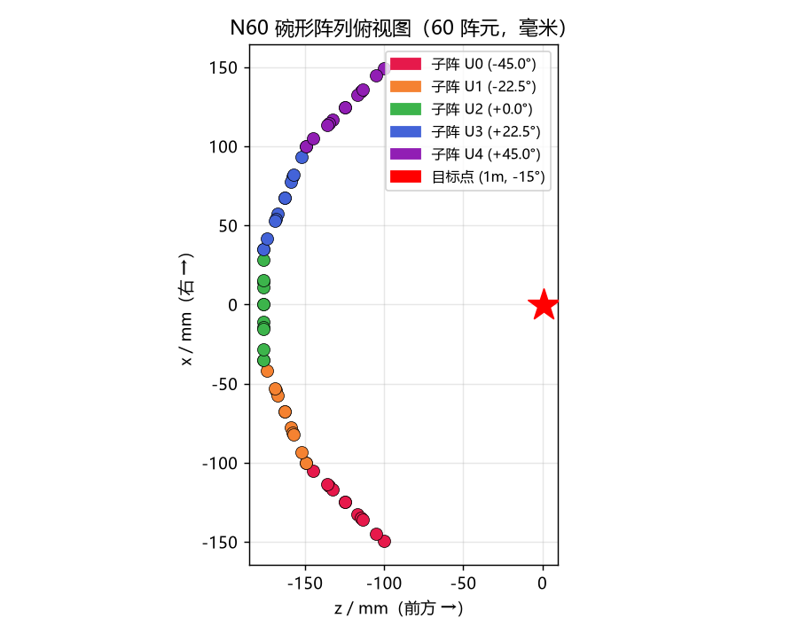
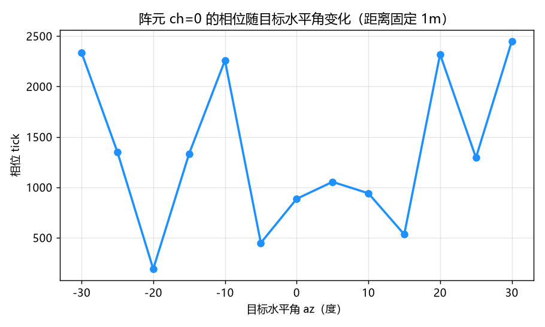
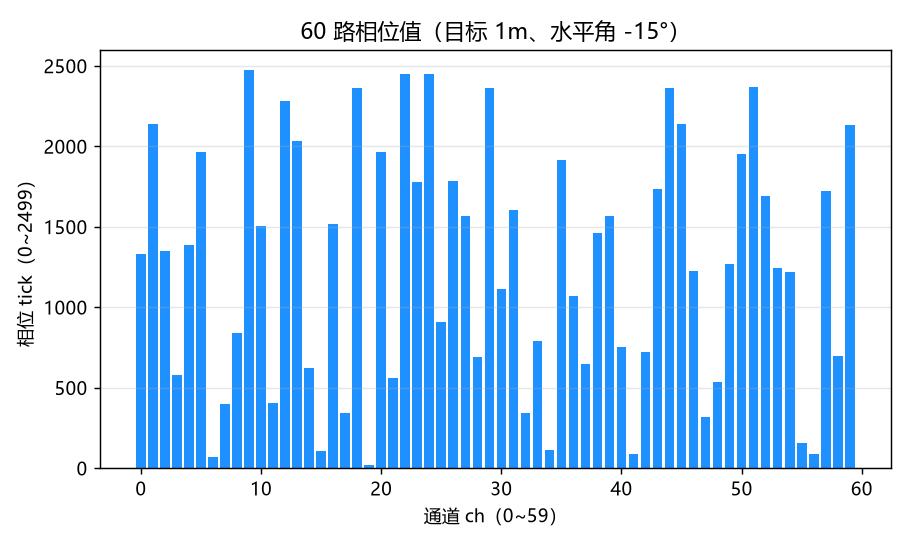
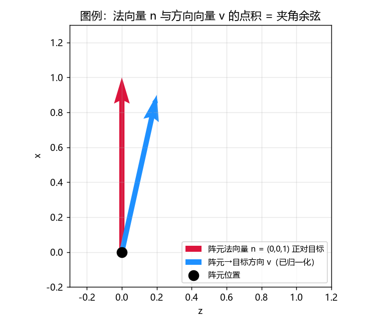
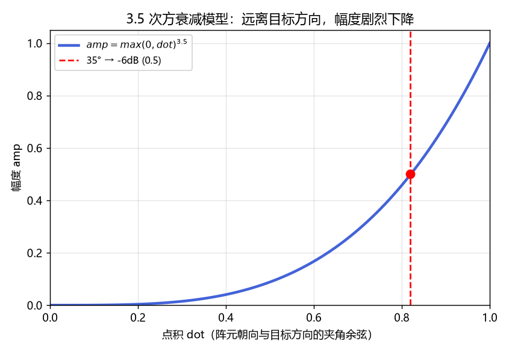
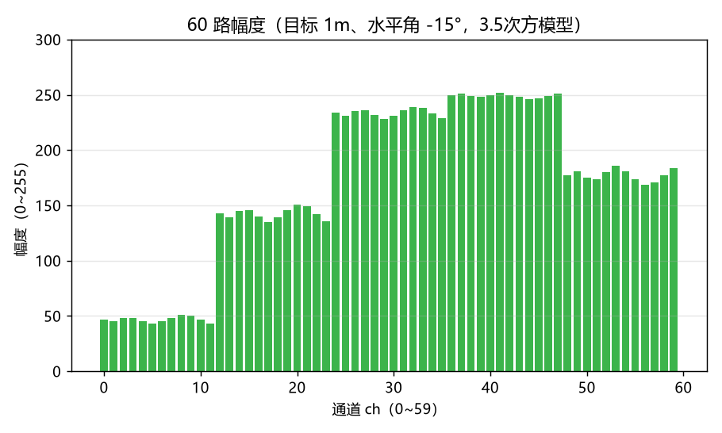
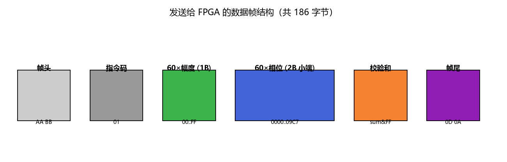

# 相位与幅度计算模型 · 详细图文讲解

> 配套文档：`N60相控阵计算原理说明.md`（整体流程）→ 本文件深入讲**相位**和**幅度**这两个核心量是如何一步步算出来的。
>
> 本文所有插图都是用**项目里真实的算法和常量**生成的真实数据图（不是手绘示意图），
> 图和数据可以和界面上运行时看到的表现相互印证。
>
> 图片目录：`images/`

---

## 目录

- [0. 先建立一点直觉](#0-先建立一点直觉)
- [1. 准备工作：60 个阵元在哪](#1-准备工作60-个阵元在哪)
- [2. 相位（phase）到底在算什么](#2-相位phase到底在算什么)
- [3. 幅度（amp）到底在算什么](#3-幅度amp到底在算什么)
- [4. 相位 + 幅度合并输出](#4-相位--幅度合并输出)
- [5. 数据帧：怎么发给 FPGA](#5-数据帧怎么发给-fpga)
- [6. 一张图看懂整套模型](#6-一张图看懂整套模型)
- [7. 亲手复现：把这篇文档变成程序](#7-亲手复现把这篇文档变成程序)

---

## 0. 先建立一点直觉

**一句话**：相控阵就像一个"会转的耳朵"。它转的不是机械，而是**时间**和**音量**。

| 你要控制的 | 实际调的是 | 对应到代码 |
|-----------|-----------|-----------|
| 耳朵转到哪（方向） | 每一路信号的"提前/推迟"程度 | **相位 phase（0~2499）** |
| 耳朵听得多专注（抑制杂音） | 每一路信号的"开多大/开多小"音量 | **幅度 amp（0~255）** |

所以整个模型其实就两件事：
1. **算 60 个时间差**（相位），让声音都汇聚到目标点；
2. **算 60 个音量**（幅度），把不朝目标阵元的声音关小。

下面一个个讲。

---

## 1. 准备工作：60 个阵元在哪

先把 60 个麦克风在空间里的位置定下来（代码里 `generate_n60_geometry()` 干的活）。

**图 1：碗形阵列 60 阵元俯视图**（5 种颜色 = 5 个子阵，红色星 = 目标点 1 米、水平角 -15°）



- 5 个子阵 `U0~U4`，整体分别朝 `-45° / -22.5° / 0° / +22.5° / +45°`；
- 所有阵元中心落在半径 **176.445 mm** 的球面上 → 呈现"碗"形；
- 第 `ch` 个通道属于第几个子阵：`unit_id = ch // 12`，在子阵内是第几个：`elem_id = ch % 12`。

> 为什么摆成碗？因为球场两侧的视线不同。碗形保证"无论目标在哪个方向，
> 总有一部分阵元是正对着它的"——这是幅度加权能起作用的前提。

### 坐标单位提醒（非常关键）

- 几何函数返回的坐标是**毫米**；
- 但相位/幅度计算公式里，"目标点到阵元的距离"要用**米**，否则会差 1000 倍。
- 所以代码里凡是在公式中用坐标，都要先 `除以 1000`（见 2.2）。

---

## 2. 相位（phase）到底在算什么

### 2.1 核心思想：让声波在目标点"对齐"

想象 60 个人站在碗形看台上喊口号，你要让口号在**看台中央的某个点**最响亮。

问题：每个人离那个点距离不同，声音到达的时间就错开了，"一、二、三！"到那儿会乱掉。

解决办法：**让离得远的先喊，离得近的后喊**，这样声波阵面会"歪"向那个点，
到达时刚好对齐 → 那个点声音最大，其他地方比较小。这就是波束"转向"的物理本质。

对接收方向同理（时间反演）：远处阵元先收到声波，本地给近处阵元多加延迟，
结果就是只"听"那个点。

### 2.2 分步公式推导

对第 `ch` 个阵元：

```
第一步：算这个阵元到目标点有多远（声程 path_m，单位米）
   path_m = √( (tx - mx/1000)² + (ty - my/1000)² + (tz - mz/1000)² )

   其中：
   (mx, my, mz)  = 阵元的坐标（毫米 → 除以 1000 变米）
   (tx, ty, tz)  = 目标点坐标（米）

第二步：算它比"参考点"（原点）多走了多少米
   路程差 = path_m - distance_m

第三步：路程差换算成"时间差"（秒）
   时间差 = 路程差 ÷ 声速 SOUND_SPEED_M_S = 路程差 ÷ 343

第四步：时间差换算成"相差几个波长周期"
   相位周期数 = 时间差 × 载波频率 CARRIER_HZ
              = (path_m - distance_m) × 40000 / 343

第五步：取小数部分，映射到 FPGA 的 0~2499
   phase = round( 相位周期数的 小数部分 × 2500 ) % 2500
```

**关键公式**（务必记住）：

```
   phase = round( frac[ (path_m - distance_m) × CARRIER_HZ / SOUND_SPEED_M_S ] × 2500 ) % 2500
```

### 2.3 为什么"取小数部分"

波形是**周期重复**的：偏 1.3 个周期和偏 0.3 个周期，效果一模一样
（多出的那 1 个完整周期 = 没偏）。所以：

- 只关心"没凑满一个周期"的零头 → 取 `% 1.0` 的小数部分；
- 把 `0~1` 的小数周期切成 `0~2499` 的 PWM 计数，FPGA 才认得。

> 直觉：**远的阵元相位算出来是"超前"（大数），取小数后折回**，
> 最终表现为给"近的阵元"补延迟，让所有声波在目标点同时到达。

### 2.4 相位随角度怎么变化（真实数据图）

以**同一个阵元 ch=0**（U0 中心阵元）为例，固定距离 1 米，把目标水平角从 -30° 扫到 +30°，
每 5° 记一次它的相位值：

**图 2：阵元 ch=0 的相位随目标水平角的变化**



可以看到，随着目标从左边（-30°）移到右边（+30°），这个阵元的相对延迟在大幅摆动
（有的象限甚至从 2400 多直接掉到 20 多——那是跨越了一个整周期，重新从 0 开始数）。

> 观察要点：相位是一条"周期数 + 取余数"的结果，所以看起来"锯齿状"跳变，
> 那其实是周期折返，不是算法出错。

再看同一目标（**1 米、水平角 -15°**）下，60 个通道各自的相位分布：

**图 3：60 路相位直方图**（目标 1m、-15°；真实计算值，范围 20~2475）



- 不同阵元离目标远近不同，相位各不相同 → 这就是"每一路延迟都不一样"。
- 相位范围横跨很大（20 ~ 2475），说明碗形阵列带来的路程差非常明显。

---

## 3. 幅度（amp）到底在算什么

### 3.1 核心思想：让正对目标的阵元多出力

相位已经让声音"指"向目标了，但还有个小问题：**每个阵元本身有一定的指向性**。

- 正对着目标方向的阵元 → 它对那个方向最灵敏，声音也传得最正，**该给大音量**；
- 斜着的阵元 → 灵敏度低，还容易同时收到杂音（旁瓣），**该给小音量，甚至归零**。

幅度这一步，就是根据"每个阵元到底多正地对准目标"来分配音量。

### 3.2 法向量与点积（图文）

每个阵元上都有一根"方向针"——**法向量 `n`**，它是垂直于麦克风表面、指向碗外的方向。
它由该阵元所在子阵的偏角 `θ` 决定：

```
   nx = -sin(θ)
   ny = 0         （碗只在水平方向倾斜，垂直分量恒为 0）
   nz =  cos(θ)
```

从阵元指向目标的方向叫**方向向量 `v`**（归一化为单位长度后）。

两者夹角的**余弦**（点积）就回答了"这个阵元正对目标的程度"：

```
   dot = vx·nx + vy·ny + vz·nz = cos(夹角)

   完全同向（阵元正对目标）  → dot = +1
   垂直（阵元侧对目标）     → dot =  0
   背对目标                → dot < 0
```

**图 4：法向量 `n` 与方向向量 `v` 的示意图**（点积 = 夹角余弦）



> 蓝色箭头 = 阵元指向目标的方向 `v`；
> 红色箭头 = 阵元法向量 `n`（它表面"朝向"的方向）。
> 夹角越小，点积越接近 1，这个阵元越"正对"目标。

### 3.3 3.5 次方衰减模型（图文）

有了点积 `dot`，再套一个衰减公式：

```
   final_amp = max(0.0, dot) ^ 3.5
```

- `max(0.0, dot)`：点积是负数（背对目标）→ 强制归 0，音量不能是负的；
- `^ 3.5`（3.5 次方）：让"偏一点就掉很多"，把旁瓣压得更干净。

**图 5：3.5 次方衰减曲线**



这一条曲线就是整个幅度模型的核心：

| 夹角 | 点积 dot | 幅度 = dot^3.5 | 直观感受 |
|------|---------|---------------|---------|
| 0°（正对） | 1.0 | **1.0（满格 255）** | 完全出力 |
| 30° | 0.866 | 0.61 | 较出力 |
| 35° | 0.819 | **0.5（-6dB）** | 正好减半，对应原厂实测 |
| 60° | 0.5 | 0.088 | 几乎没力气 |
| 90°（侧对） | 0.0 | **0** | 完全静音 |
| >90°（背对） | <0 | **0** | 完全静音 |

> 为什么是 3.5 次方？来自原厂麦克风实测 `-6dB@35°`。
> 用 3.5 次方，正好在 35° 处衰减到 0.5（-6dB），和硬件实测吻合；
> 同时它比 "点积的一次方" 衰减更快，能显著压低旁瓣。

### 3.4 幅度随角度怎么变化（真实数据图）

同样目标（**1 米、水平角 -15°**）下，60 路的幅度分布：

**图 6：60 路幅度直方图**（真实计算值，范围 43~252）



观察：

- 和目标同向（-15° 附近的子阵 U2）幅度最大，接近满格；
- 偏得越远的阵元幅度越小；
- 因为目标在 -15°，正好落在 -22.5° 和 0° 两个子阵之间，两边阵元都较正对目标，
  所以这片区域幅度都挺高——这就是"碗形"的意义。

> 注意：这张图里没有通道被压到 0，因为目标在水平面内、所有阵元都朝目标一侧。
> 如果目标很偏（接近 ±30° 极限）或带俯仰角，背对目标的阵元就会被压到接近 0。

---

## 4. 相位 + 幅度合并输出

相位和幅度是**两套独立列表**，逐通道合并：

```
   current_phases[ch]   ← 相位（0~2499，整数 tick）
   current_amps[ch]     ← 幅度（0~255，整数）
```

界面上 60 个格子就是同时显示这两列的（如 `U0E3 / CH:03 / 幅度:146 / 相位:0020`），
幅度越大格子越亮（青色越浓）。

把小数幅度转成 0~255：

```
   amp_255 = int( round( clamp(0, 1, amp) × 255 ) )
```

---

## 5. 数据帧：怎么发给 FPGA

算完 60×相位 + 60×幅度，打包成一串字节（`make_packet()`）：

**图 7：发给 FPGA 的数据帧结构（共 186 字节）**



| 字段 | 字节数 | 说明 |
|------|--------|------|
| 帧头 `0xAA 0xBB` | 2 | FPGA 靠它认出"数据开始" |
| 指令码 `0x01` | 1 | "更新参数"命令 |
| 60 × 幅度 | 60 | 每路 1 字节（0~255） |
| 60 × 相位 | 120 | 每路 2 字节，**小端序**，0~2499 |
| 校验和 | 1 | `sum(packet[2:]) & 0xFF`，传输检错 |
| 帧尾 `0x0D 0x0A` | 2 | 回车+换行，表示"结束" |

总长度 = 2 + 1 + 60 + 120 + 1 + 2 = **186 字节**。

---

## 6. 一张图看懂整套模型

把整个"拖动滑块 → 发数据"链路浓缩成一句话公式链：

```
用户输入(距离D, 水平角az, 俯仰角el)
   │
   ▼
限幅 → 方向单位向量 (sx, sy, sz)            ← limit_direction_n60()
   │
   ▼
目标点 = D × (sx, sy, sz)   (米)
   │
   ├──────────────┬──────────────────────────┐
   ▼              ▼                          ▼
对每个通道 ch     对每个通道 ch              对每个通道 ch
算路径差 → 相位   算法向量n·方向v → 点积      → 发FPGA
(相位取小数×2500)  (幅度取 dot^3.5 ×255)
   │              │
   ▼              ▼
current_phases[ch]  current_amps[ch]
   │              │
   └──────┬───────┘
          ▼
make_packet() → 186字节帧 → SerialLogic.send() → FPGA
```

---

## 7. 亲手复现：把这篇文档变成程序

不想看图形界面？下面这个用**纯 Python + 项目真实算法**复现的完整程序，
没有任何第三方依赖（PyQt6 都不需要），打印出 60 路的相位和幅度。

```python
import math

# ===== 与项目一致的常量 =====
SOUND_SPEED_M_S = 343.0
CARRIER_HZ      = 40000.0
PWM_PERIOD_TICKS = 2500
BOWL_RADIUS_MM  = 176.445
UNIT_ANGLES_DEG = [-45.0, -22.5, 0.0, 22.5, 45.0]
N12_LOCAL_COORDS = [
    (0.000, 0.000), (14.280, 10.958), (-10.958, 14.280), (-14.280, -10.958),
    (10.958, -14.280), (35.097, 8.011), (15.620, 32.435), (-15.620, 32.435),
    (-35.097, 8.011), (-28.146, -22.446), (0.000, -36.000), (28.146, -22.446),
]

def geometry_mm():
    coords = []
    for theta in [math.radians(a) for a in UNIT_ANGLES_DEG]:
        cx = BOWL_RADIUS_MM * math.sin(theta)
        cz = -BOWL_RADIUS_MM * math.cos(theta)
        for lx, ly in N12_LOCAL_COORDS:
            coords.append((cx + lx*math.cos(theta), ly, cz + lx*math.sin(theta)))
    return coords

def compute(distance_mm, az_deg, el_deg=0.0):
    coords = geometry_mm()
    dist_m = distance_mm / 1000.0
    # 限幅（最大 30°）
    ax = math.radians(az_deg); ey = math.radians(el_deg)
    sx = math.sin(ax); sy = math.sin(ey)
    ms = math.sin(math.radians(30.0)); sxy = math.hypot(sx, sy)
    if sxy > ms:
        k = ms / sxy; sx *= k; sy *= k
    sz = math.sqrt(max(0.0, 1 - sx*sx - sy*sy))
    target = (dist_m*sx, dist_m*sy, dist_m*sz)

    print(f"{'ch':>3} {'unit':>4} {'相位 tick':>9} {'幅度 0-255':>10} {'幅度率%':>7}")
    for ch in range(60):
        mx, my, mz = coords[ch]
        # ---- 相位 ----
        path = math.sqrt((target[0]-mx/1000)**2 + (target[1]-my/1000)**2 + (target[2]-mz/1000)**2)
        phase_cycles = (path - dist_m) * CARRIER_HZ / SOUND_SPEED_M_S
        phase = int(round((phase_cycles % 1.0) * PWM_PERIOD_TICKS)) % PWM_PERIOD_TICKS
        # ---- 幅度（3.5次方模型）----
        ui = ch // 12
        th = math.radians(UNIT_ANGLES_DEG[ui])
        nx, ny, nz = -math.sin(th), 0.0, math.cos(th)     # 法向量
        vx = target[0]-mx/1000; vy = target[1]-my/1000; vz = target[2]-mz/1000
        vlen = math.sqrt(vx*vx+vy*vy+vz*vz)
        dot = (vx*nx + vy*ny + vz*nz) / vlen
        amp = max(0.0, dot) ** 3.5
        amp255 = int(round(max(0.0, min(1.0, amp)) * 255))
        print(f"{ch:>3}  U{ui}   {phase:>9}   {amp255:>10}   {amp*100:>6.1f}%")

# 改动这行就能看不同目标的效果
compute(distance_mm=1000, az_deg=-15.0)
```

运行这个小脚本，你将看到和**图 3、图 6 一致**的 60 行数字：
- 相位在 20~2475 之间摆动；
- 幅度中间的子阵（U2 附近）最高、两边递减。

> 把 `az_deg` 改成 `30` 看极限偏转、改成 `1`（近处）看距离影响，
> 亲手体会"方向改变相位、夹角改变幅度"这两条规律。

---

## 附：图片文件清单（`images/`）

| 文件名 | 内容 |
|--------|------|
| `fig_array_top.png` | 碗形阵列 60 阵元俯视图 + 目标点 |
| `fig_phase_vs_az.png` | 单阵元相位随目标水平角的变化 |
| `fig_phase_bars.png` | 60 路相位直方图（1m、-15°） |
| `fig_power35.png` | 3.5 次方衰减曲线 |
| `fig_amp_bars.png` | 60 路幅度直方图（1m、-15°） |
| `fig_dot_product.png` | 法向量与方向向量点积示意图 |
| `fig_packet.png` | 186 字节数据帧结构图 |
